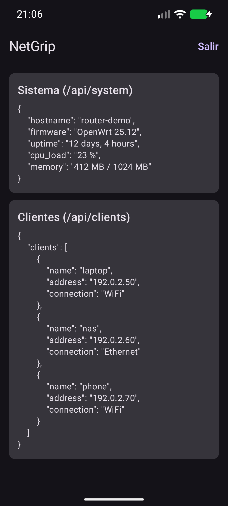

# NetGrip Mobile

[Read in English](README.md)

App móvil nativa para [NetGrip](https://github.com/gnacho/netgrip), un panel de gestión de routers OpenWrt. Usa Kotlin Multiplatform y Compose Multiplatform. Android es el primer objetivo, con los targets de iOS preparados desde el inicio.

## Captura



*Datos simulados para la captura.*

## Estado

Este es el shell de solo lectura más las primeras acciones seguras sobre clientes. La pestaña de clientes permite renombrar un dispositivo, fijar su tipo, bloquearlo o desbloquearlo por banda, fijar o quitar su IP actual y enviar un paquete Wake on LAN. Toda escritura pide confirmación, muestra el error del servidor y vuelve a leer el estado del router. El resto de la app sigue en solo lectura. Los tests de host de Android y la compilación del APK de depuración pasan. Las pruebas en emulador y contra un router real siguen pendientes.

El shell está descrito en [docs/readonly-shell.md](docs/readonly-shell.md) y las escrituras en [docs/client-writes.md](docs/client-writes.md).

## Requisitos

- JDK 17
- Android Studio con soporte para AGP 9.5
- Android SDK con platform 37
- Gradle 9.7.0 mediante el wrapper

Si `gradlew` no tiene permiso de ejecución, ejecuta `chmod +x gradlew`.

## Estructura

```text
shared/       API, sesión, storage cifrado, viewmodels y UI Compose compartidos
androidApp/   punto de entrada Android, MainActivity y manifiesto
iosApp/       placeholder documentado, requiere Mac
docs/         ADRs y especificación de la fase 1
```

El módulo `shared` usa el plugin `com.android.kotlin.multiplatform.library` de AGP 9. La app Android usa el Kotlin integrado de AGP, por lo que no aplica el plugin `org.jetbrains.kotlin.android`.

## Comandos principales

```sh
./gradlew :shared:testAndroidHostTest
./gradlew :androidApp:assembleDebug
```

El primer comando ejecuta los tests de `commonTest` con Ktor MockEngine. El segundo genera el APK de depuración.

## Seguridad

- Se guarda el token de sesión cifrado en vez de la contraseña por defecto. Android usa Android Keystore e iOS usará Keychain.
- Un 401 marca la sesión como caducada y vuelve al login. Un 429 respeta `Retry-After`.
- La app no acepta todos los certificados TLS. La huella por router está prevista para la fase 2.

Los detalles están en [ADR 0002](docs/adr/0002-sesiones-y-secretos.md) y [ADR 0003](docs/adr/0003-tls-huella-por-router.md).

## Licencia

AGPL-3.0. Ver [LICENSE](LICENSE). Si en el futuro se reutiliza código de luci-mobile, se mantendrán sus avisos GPL-3.0. Ver [ADR 0001](docs/adr/0001-app-nativa-kmp.md).
