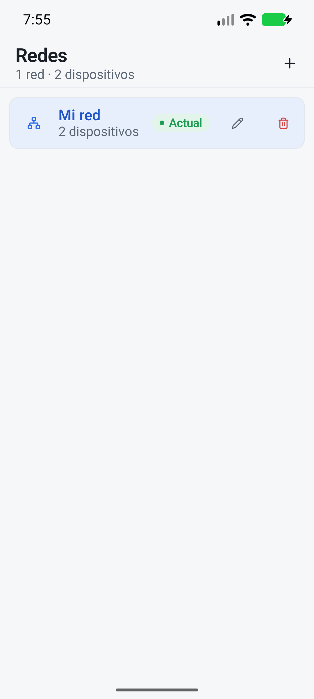

# NetGrip Mobile

[Read in English](README.md)

App móvil nativa para [NetGrip](https://github.com/gnacho/netgrip), un panel de gestión de routers OpenWrt. Usa Kotlin Multiplatform y Compose Multiplatform. Android es el primer objetivo, con los targets de iOS preparados desde el inicio.

## Captura


*Datos simulados para la captura.*

## Estado

Este es el shell de solo lectura más las primeras acciones seguras sobre clientes. La pestaña de clientes permite renombrar un dispositivo, fijar su tipo, bloquearlo o desbloquearlo por banda, fijar o quitar su IP actual y enviar un paquete Wake on LAN. Toda escritura pide confirmación, muestra el error del servidor y vuelve a leer el estado del router. El resto de la app sigue en solo lectura.

La pestaña WiFi permite renombrar una red, cambiar su clave y seguridad, ocultarla o dejar de emitirla, ajustar canal, ancho y potencia de cada radio configurar las redes de invitados e IoT y poner un horario semanal por banda. Cada cambio se confirma, arma la ventana de reversión del router con cuenta atrás, no muestra la clave y relee el estado. Detalle en [docs/wifi-writes.md](docs/wifi-writes.md).

La pestaña Ajustes permite reiniciar el router, esperando a que vuelva a responder, cambiar la contraseña de administración, lo que cierra todas las sesiones del panel y devuelve al login, instalar el firmware del router cuando owut lo considera seguro y actualizar el panel NetGrip. Detalle en [docs/system-actions.md](docs/system-actions.md).

La app guarda tantas redes y routers como haga falta. La cabecera tiene un selector de red y otro de dispositivo, cada uno con su hoja, y cada router conserva su propia sesión cifrada. Los dispositivos se añaden por URL con las credenciales en el momento, o se importan del fleet del router. Detalle en [docs/multi-network.md](docs/multi-network.md).

Pasan 263 tests de host de Android y la compilación del APK de depuración. Las pruebas en emulador están hechas contra una API simulada. Falta la validación contra un router real.

El shell está descrito en [docs/readonly-shell.md](docs/readonly-shell.md), las escrituras en [docs/client-writes.md](docs/client-writes.md), las de WiFi en [docs/wifi-writes.md](docs/wifi-writes.md), las de sistema en [docs/system-actions.md](docs/system-actions.md) y las redes y dispositivos en [docs/multi-network.md](docs/multi-network.md).

## Navegación

La app sigue el modelo de datos: la pantalla de inicio es el listado de redes, al tocar una se ven sus dispositivos y al abrir un dispositivo aparece su configuración. El botón atrás del sistema recorre el mismo camino al revés. La cabecera del dispositivo mantiene las pastillas de red y dispositivo como atajo.

<p float="left">
  
  
</p>

## Interfaz

La app reproduce el sistema visual del panel web de NetGrip en vez de inventar otro: la misma paleta clara y oscura, espaciados, radios, bordes de tarjeta, pills y escala tipográfica, tomados de `app/src/index.css` del panel. La navegación es un menú lateral agrupado: fijo en pantallas anchas, rail en tablet y desplegable en el móvil. Los tres modos de tema se guardan en el dispositivo.

Los iconos son los mismos vectores Lucide que usa el panel web, generados como `ImageVector` de Compose a partir de los SVG originales. No se empaqueta ningún pack de iconos, así que el resultado coincide sin sumar decenas de megas.

El Panel dibuja una gráfica real de tráfico con `GET /api/history`, que el router muestrea cada cinco minutos y guarda 24 horas. La gráfica muestra tasas derivadas de los contadores acumulados, con ventana de 1, 6 o 24 horas y guía al tocar. El detalle del cliente muestra el tráfico de la conexión actual como barra repartida, porque la API no guarda serie por cliente.

## Requisitos

- JDK 17
- Android Studio con soporte para AGP 9.5
- Android SDK con platform 37
- Gradle 9.7.0 mediante el wrapper

Si `gradlew` no tiene permiso de ejecución, ejecuta `chmod +x gradlew`.

## Estructura

```text
shared/       API, sesión, storage cifrado, viewmodels y UI Compose compartidos
androidApp/   punto de entrada Android, MainActivity y manifiesto
iosApp/       placeholder documentado, requiere Mac
docs/         ADRs y especificación de la fase 1
```

El módulo `shared` usa el plugin `com.android.kotlin.multiplatform.library` de AGP 9. La app Android usa el Kotlin integrado de AGP, por lo que no aplica el plugin `org.jetbrains.kotlin.android`.

## Comandos principales

```sh
./gradlew :shared:testAndroidHostTest
./gradlew :androidApp:assembleDebug
```

El primer comando ejecuta los tests de `commonTest` con Ktor MockEngine. El segundo genera el APK de depuración.

## Seguridad

- Se guarda el token de sesión cifrado en vez de la contraseña por defecto. Android usa Android Keystore e iOS usará Keychain.
- Un 401 marca la sesión como caducada y vuelve al login. Un 429 respeta `Retry-After`.
- La app no acepta todos los certificados TLS. La huella por router está prevista para la fase 2.

Los detalles están en [ADR 0002](docs/adr/0002-sesiones-y-secretos.md) y [ADR 0003](docs/adr/0003-tls-huella-por-router.md).

## Licencia

AGPL-3.0. Ver [LICENSE](LICENSE). Si en el futuro se reutiliza código de luci-mobile, se mantendrán sus avisos GPL-3.0. Ver [ADR 0001](docs/adr/0001-app-nativa-kmp.md).
