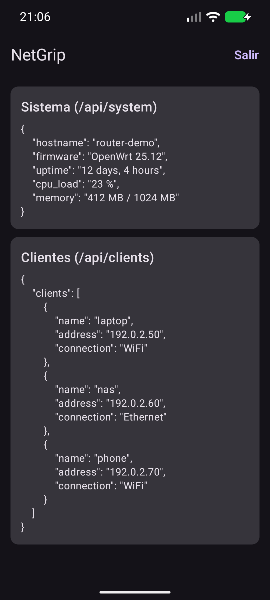
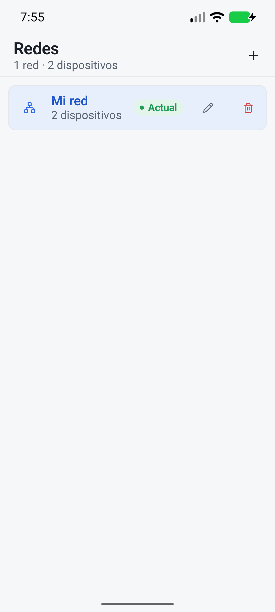
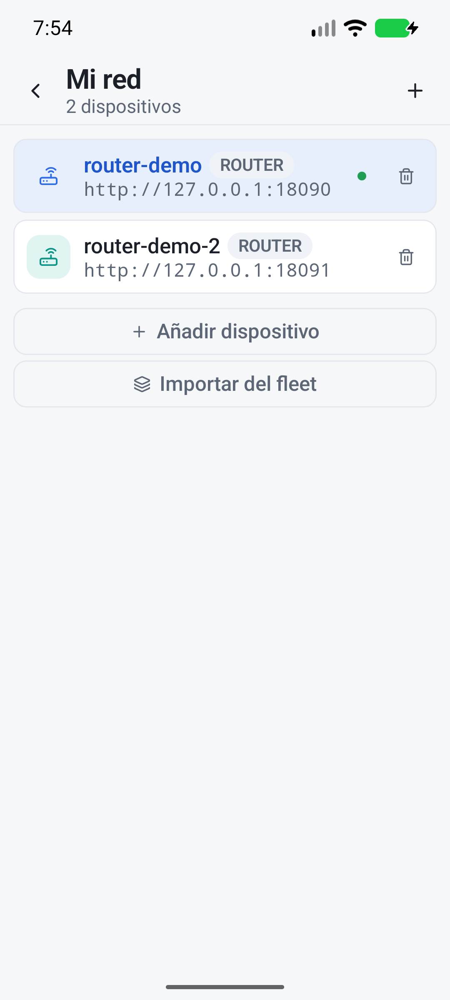

# NetGrip Mobile

[Leer en castellano](README.es.md)

NetGrip Mobile is a native mobile client for [NetGrip](https://github.com/gnacho/netgrip), an OpenWrt management panel. It uses Kotlin Multiplatform and Compose Multiplatform. Android is the first target, with iOS targets already configured.

## Screenshot



*Simulated data for the screenshot.*

## Status

This is the read-only shell plus the first safe client actions. The client tab can rename a device, set its type, block or unblock it per band, pin or remove its current IP and send a Wake on LAN packet. Every write asks for confirmation, shows the server error and re-reads the router state. The rest of the app stays read-only.

The WiFi tab can rename a network, change its key and security, hide it or stop emitting it, set the channel, width and power of each radio, configure the guest and IoT networks and set a weekly schedule per band. Every change is confirmed, arms the router rollback window with a countdown, keeps the key write only and re-reads the state. See [docs/wifi-writes.md](docs/wifi-writes.md).

The Settings tab can reboot the router, waiting until it answers again, change the admin password, which closes every panel session and returns to the login, install router firmware when owut reports it is safe, update the NetGrip panel and schedule that update daily or weekly inside a two hour window. See [docs/system-actions.md](docs/system-actions.md).

The app can also hold as many networks and routers as needed. The header has a network selector and a device selector, each with its own sheet, and every router keeps its own encrypted session. Devices can be added by URL with inline credentials, or imported from the router fleet. See [docs/multi-network.md](docs/multi-network.md).

264 Android host tests and the debug APK build pass. Emulator tests are done against a mock API. Validation against a real router is still pending.

The shell is described in [docs/readonly-shell.md](docs/readonly-shell.md), the client writes in [docs/client-writes.md](docs/client-writes.md), the WiFi writes in [docs/wifi-writes.md](docs/wifi-writes.md), the system actions in [docs/system-actions.md](docs/system-actions.md) and the network and device handling in [docs/multi-network.md](docs/multi-network.md).

## Navigation

The app follows the data model: the home screen is the list of networks, tapping one shows its devices, and opening a device shows its configuration. The system back button walks the same path in reverse. The device header still has network and device chips as shortcuts.

<p float="left">
  
  
</p>

## Interface

The app reproduces the NetGrip web visual system instead of inventing a second one: the same light and dark palettes, spacing, radii, card borders, pills and typography scale, taken from `app/src/index.css` of the web panel. Navigation is a grouped side menu, a permanent drawer on wide screens, a rail on tablets and a modal drawer on phones. The three theme modes are stored on the device.

Icons are the Lucide vectors the web panel uses, generated as Compose `ImageVector`s from the original SVG path data. No icon pack is bundled, so the look matches without adding tens of megabytes.

The Panel draws a real traffic chart from `GET /api/history`, which the router samples every five minutes and keeps for 24 hours. The chart shows rates derived from the accumulated counters, with a 1, 6 or 24 hour window and a touch crosshair. Client detail shows the traffic of the current connection as a split bar, because the API keeps no per-client series.

## Requirements

- JDK 17
- Android Studio with support for AGP 9.5
- Android SDK platform 37
- Gradle 9.7.0 through the wrapper

If `gradlew` is not executable, run `chmod +x gradlew`.

## Project structure

```text
shared/       shared API, session, encrypted storage, view models, and Compose UI
androidApp/   Android entry point, MainActivity and manifest
iosApp/       documented placeholder, requires a Mac
docs/         ADRs and phase 1 specification
```

The `shared` module uses the `com.android.kotlin.multiplatform.library` plugin from AGP 9. The Android app uses the Kotlin support built into AGP, so it does not apply `org.jetbrains.kotlin.android`.

## Main commands

```sh
./gradlew :shared:testAndroidHostTest
./gradlew :androidApp:assembleDebug
```

The first command runs the `commonTest` suite with Ktor MockEngine. The second builds the debug APK.

## Security

- Store the encrypted session token instead of the password by default. Android uses Android Keystore and iOS will use Keychain.
- A 401 response marks the session as expired and returns to the login screen. A 429 response respects `Retry-After`.
- The app does not accept every TLS certificate. Per-router certificate fingerprint support is planned for phase 2.

See [ADR 0002](docs/adr/0002-sesiones-y-secretos.md) and [ADR 0003](docs/adr/0003-tls-huella-por-router.md) for details.

## License

AGPL-3.0. See [LICENSE](LICENSE). If code from luci-mobile is reused in the future, its GPL-3.0 notices will be retained. See [ADR 0001](docs/adr/0001-app-nativa-kmp.md).
